# Technical Spike & Architecture Research: Authentication Strategy

> **Document:** Authentication Architecture Evaluation and Trade-off Analysis  
> **Context:** MESW — Software Engineering Laboratory (2026/27)  
> **Product:** Patas — Collaborative Animal Welfare Platform  
> **Architecture Context:** Next.js (Frontend / BFF) + FastAPI (Backend / Domain Core) + PostgreSQL 16  
> **Related Documents:** [[DomainModel]], [[DatabaseDesignDecisions]], [[create.sql]]

---

## 1. Executive Summary & Core Engineering Principle

A fundamental rule of modern software engineering and security is: **"Never roll your own authentication or cryptography from scratch"**. Writing custom password hashing, token validation, session management, and credential recovery introduces critical vulnerabilities, high maintenance costs, and zero domain value to the animal protection mission of Patas.

Our relational baseline in [[create.sql]] intentionally models `patas.users` as a **clean domain profile entity** (`id`, `name`, `email`, `is_platform_admin`), deliberately **omitting credential columns** (such as `password_hash` or `salt`). This decouples identity authentication from domain authorization and allows any hardened third-party identity system to be integrated seamlessly.

With the team transition to **Next.js** (which provides a server-side runtime via Route Handlers, Server Actions, and Middleware), this spike evaluates the three leading architectural options for securing the communication between Next.js, FastAPI, and PostgreSQL.

---

## 2. Architectural Options Evaluated

```mermaid
flowchart TD
    subgraph opt1["Option 1: Better-Auth"]
        O1_Browser["Browser / Next.js Client"] -->|Session Cookie| O1_Next["Next.js Server / Better-Auth"]
        O1_Next -->|Read/Write Auth| O1_DB[("Postgres: patas_auth")]
        O1_Next -->|Bearer JWT| O1_FastAPI["FastAPI Domain API"]
        O1_FastAPI -->|Domain Queries| O1_DomainDB[("Postgres: patas")]
    end

    subgraph opt2["Option 2: Managed IdP (Clerk / Supabase)"]
        O2_Browser["Browser / Next.js"] -->|OIDC / OAuth2| O2_Clerk["Managed IdP Service"]
        O2_Clerk -->|Signed JWT| O2_Browser
        O2_Browser -->|Bearer JWT| O2_FastAPI["FastAPI Domain API"]
        O2_FastAPI -->|Verify JWKS| O2_Clerk
        O2_FastAPI -->|Domain Queries| O2_DomainDB[("Postgres: patas")]
    end

    subgraph opt3["Option 3: Backend-Centric (FastAPI-Users)"]
        O3_Browser["Browser / Next.js"] -->|Login POST| O3_FastAPI["FastAPI / fastapi-users"]
        O3_FastAPI -->|Session / Bearer JWT| O3_Browser
        O3_FastAPI -->|Auth + Domain Queries| O3_DomainDB[("Postgres: patas")]
    end
```



---

### Option 1: Better-Auth in Next.js (with JWT Handoff to FastAPI)

#### Overview
[Better-Auth](https://better-auth.com) is a modern, open-source TypeScript authentication framework specifically designed for modern web applications. Because Next.js has a Node.js server environment, Better-Auth runs directly inside Next.js Route Handlers (`/api/auth/[...all]`).

#### Interaction Flow
1. **User Authentication:** The citizen or staff member submits credentials to Next.js. Better-Auth handles signup, signin, password hashing (Argon2), email verification, and OAuth (e.g., Google).
2. **Persistence:** Better-Auth writes to authentication tables (`user`, `session`, `account`, `verification`) located in a dedicated PostgreSQL schema (e.g., `patas_auth`), isolating them from the domain schema (`patas`).
3. **API Handoff (JWT Plugin):** Using Better-Auth's `jwtPlugin`, Next.js generates a signed JSON Web Token (JWT) on behalf of the authenticated session.
4. **FastAPI Verification:** When Next.js (or the browser) calls the FastAPI backend, it supplies `Authorization: Bearer <token>`. FastAPI validates the token signature using a shared secret or public key without making any database calls for session lookup.

#### Trade-offs
* **Strengths:**
  * **100% Self-Contained & Local:** Runs completely inside Docker without internet access or paid third-party dependencies, an essential factor for offline academic evaluation.
  * **Outstanding Next.js Developer Experience:** Provides native React hooks (`useSession()`), Server Component helpers, middleware integration, and support for 2FA and Passkeys out of the box.
  * **Zero Session DB Overhead on FastAPI:** FastAPI verifies cryptographic JWT signatures statelessly in microseconds.
* **Challenges & Mitigation:**
  * **Dual Database Connections:** Both Next.js and FastAPI connect to PostgreSQL.  
    *Mitigation:* Strict schema isolation (`patas_auth` for Better-Auth vs. `patas` for domain models).
  * **User Identity Sync:** When a user signs up via Better-Auth, FastAPI needs a corresponding row in `patas.users`.  
    *Mitigation:* Use a "Just-In-Time" (JIT) provisioning pattern: upon the first authenticated API call, FastAPI checks if `patas.users` has that UUID; if not, it inserts the initial record.

---

### Option 2: Managed Identity Provider (Clerk / Supabase Auth)

#### Overview
Authentication is completely offloaded to a specialized cloud service (e.g., Clerk or Supabase Auth). The frontend utilizes pre-built UI components, while the backend verifies standard OIDC/OAuth2 tokens.

#### Interaction Flow
1. **Frontend Integration:** Next.js embeds official provider components (`<SignIn />`, `<UserButton />`) and uses middleware for route guarding.
2. **Token Issuance:** The user logs in via the managed provider, which issues an RS256-signed JWT.
3. **Backend Verification:** FastAPI fetches the provider's JSON Web Key Set (JWKS) during startup, cache-validates tokens, and extracts the claims (`sub`, `email`).

#### Trade-offs
* **Strengths:**
  * **Zero Auth Code:** Pre-built, accessible, and polished UI components for login, password reset, 2FA, and OAuth.
  * **Maximum Separation of Concerns:** Neither Next.js nor FastAPI touches password hashes, email delivery infra, or brute-force rate-limiting.
  * **Zero Auth Tables in PostgreSQL:** The database contains only domain data.
* **Challenges & Mitigation:**
  * **External Cloud Dependency:** Requires active internet connectivity.  
    *Mitigation:* During offline defenses, mock JWKS keys or a local stub must be configured if network access is restricted.

---

### Option 3: Backend-Centric Authentication (FastAPI-Users)

#### Overview
The Python FastAPI backend remains the single source of truth for all database operations, exposing standard OAuth2/JWT endpoints via the `fastapi-users` library. Next.js acts strictly as an HTTP client.

#### Interaction Flow
1. **Frontend Submission:** Next.js renders custom HTML/React forms and POSTs credentials to `POST /api/v1/auth/jwt/login`.
2. **FastAPI Handling:** `fastapi-users` verifies credentials against an auth table in PostgreSQL and returns an access token.
3. **Next.js Usage:** Next.js stores the token (typically in an HttpOnly cookie via a Route Handler) and forwards it on subsequent calls.

#### Trade-offs
* **Strengths:**
  * **Classic Single-Tier Architecture:** Only FastAPI connects to the PostgreSQL database.
  * **100% Local Execution:** Fully contained in Python and Docker.
* **Challenges & Mitigation:**
  * **Higher Frontend Effort:** The team must manually build all login, registration, password recovery, and error-handling screens from scratch.
  * **No Built-in Next.js Ecosystem Perks:** Server Components and route middleware must be orchestrated manually without turn-key React hooks.

---

## 3. Comparative Decision Matrix

| Evaluation Criterion | Option 1: Better-Auth (Next.js) | Option 2: Clerk / Supabase (Cloud IdP) | Option 3: FastAPI-Users (Python) |
| :--- | :--- | :--- | :--- |
| **Implementation Speed** | ⚡ High (fast setup + pre-built hooks) | ⚡⚡ Very High (turn-key UI) | ⏳ Moderate (custom forms required) |
| **Local Docker Portability (Offline)** |  **100% Self-Contained** | ❌ Requires Cloud / Internet |  **100% Self-Contained** |
| **Next.js Developer Experience (DX)** |  **Native TypeScript & SSR** |  **Native TypeScript & SSR** | ⚠️ Manual Cookie/Token Forwarding |
| **Database Decoupling** | Separate schemas (`patas_auth` / `patas`) | Total decoupling (zero auth tables) | Auth tables co-located in backend |
| **Security Standards** | Modern (Argon2, Passkeys, OAuth) | Enterprise (SOC2, Passkeys, 2FA) | Standard (Bcrypt/Argon2 + JWT) |
| **Academic Defense Feasibility** |  **Excellent** (modern, open-source) | ⚠️ May draw questions on cloud reliance |  **Excellent** (classic architecture) |

---

## 4. Alignment with the Relational Schema (`create.sql`)

Whichever strategy is chosen, the domain schema in [[create.sql]] remains clean and consistent:

1. **Clean Aggregate Root:**  
   `patas.users` requires **zero modification**. It continues to represent the business persona of a citizen:
   ```sql
   CREATE TABLE users (
       id uuid NOT NULL DEFAULT gen_random_uuid(),
       name text NOT NULL,
       email text UNIQUE NOT NULL,
       is_platform_admin boolean NOT NULL DEFAULT false,
       created_at timestamptz NOT NULL DEFAULT now(),
       updated_at timestamptz NOT NULL DEFAULT now()
   );
   ```
2. **Just-In-Time (JIT) Provisioning Pattern:**  
   When an authenticated request reaches FastAPI:
   * FastAPI extracts `user_id = token.sub` and `email = token.email`.
   * A FastAPI dependency (`get_current_active_user`) queries `SELECT * FROM patas.users WHERE id = :user_id`.
   * If not found, it runs an `INSERT` to synchronize the profile automatically on first sign-in.
3. **Database Schema Namespacing:**  
   If Option 1 (Better-Auth) is selected, configure Better-Auth to use its own schema:
   ```ts
   // In Next.js Better-Auth configuration
   export const auth = betterAuth({
       database: new Pool({ ... }),
       schema: "patas_auth", // Keeps core 'patas' schema completely unpolluted
   });
   ```

---

## 5. Recommended Path Forward

1. **Primary Recommendation:**  
   Adopt **Option 1 (Better-Auth with JWT plugin in Next.js)**.  
   * **Why:** Delivers modern Next.js developer ergonomics (SSR, reactive hooks, zero custom auth boilerplate) while running 100% offline within the team's `docker compose` stack without external vendor lock-in.
2. **Fallback Alternative:**  
   If the team prefers a hosted solution during development to save time on UI screens, **Option 2 (Clerk)** can be plugged in trivially by switching the Next.js frontend provider, since FastAPI only ever validates standard Bearer JWTs in both cases.
