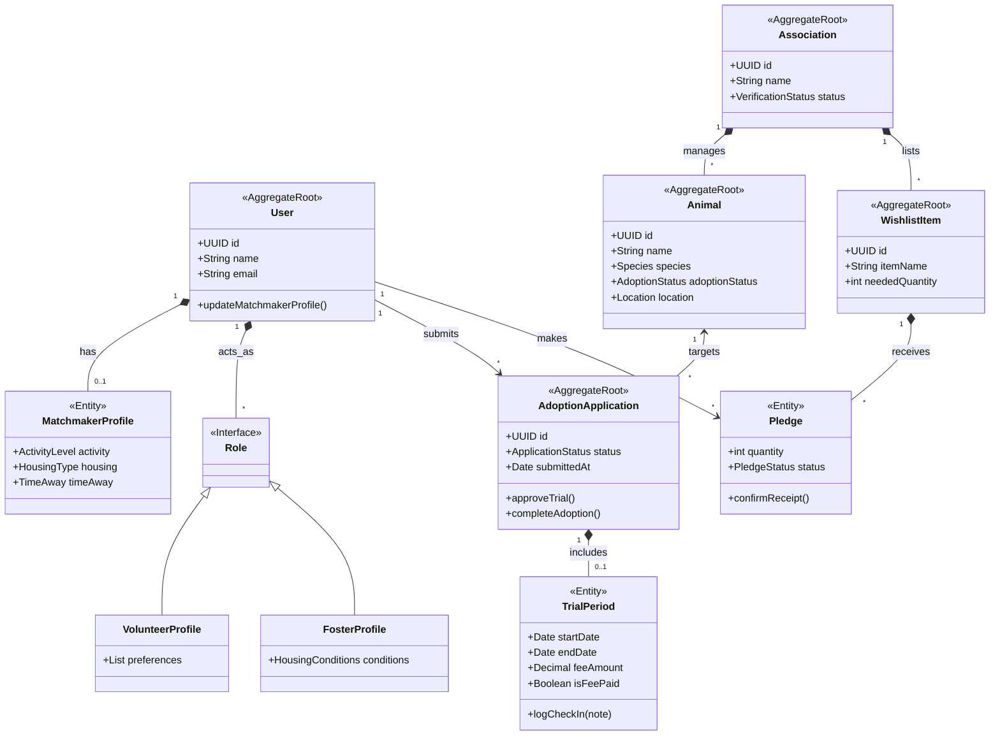

# Conceptual Domain Model

This document outlines the core aggregates, entities, and relationships for the Patas platform, adhering strictly to Object-Oriented principles.

## Core UML Domain Model

## Modeling Decisions & Rationale

1. **Composition over Inheritance for Roles:** 
   A `User` *has* a collection of `Role` objects (like `VolunteerProfile` or `FosterProfile`). This allows a single person to dynamically gain or lose capabilities (e.g., becoming a volunteer for a while, then stopping) without changing their underlying base class.
2. **Matchmaker Profile as an Entity:** 
   The `MatchmakerProfile` is stored as an editable entity tied to the `User`, allowing citizens to update their lifestyle conditions over time to get better animal recommendations.
3. **Trial Period as a Separate Entity:** 
   The `TrialPeriod` is a distinct entity within the `AdoptionApplication` aggregate. Because it is optional, making it a separate object prevents the `AdoptionApplication` from being cluttered with null fields (like `trialStartDate`, `trialFee`) for standard adoptions. It also encapsulates its own specific logic (like logging check-ins and tracking fee payments).
