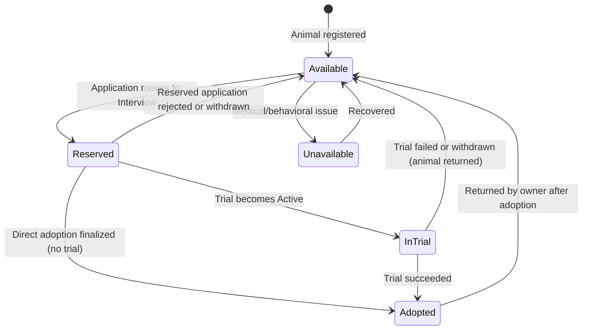
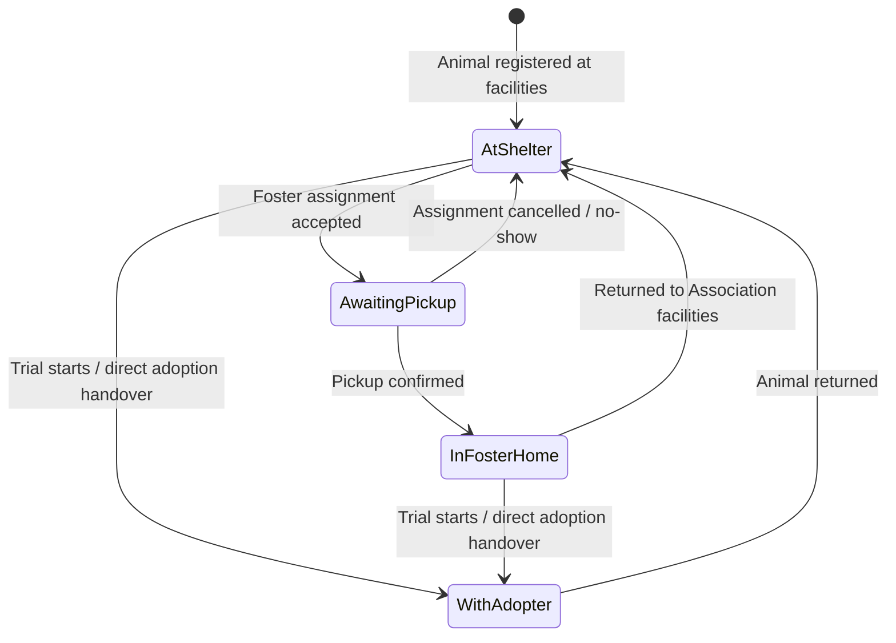
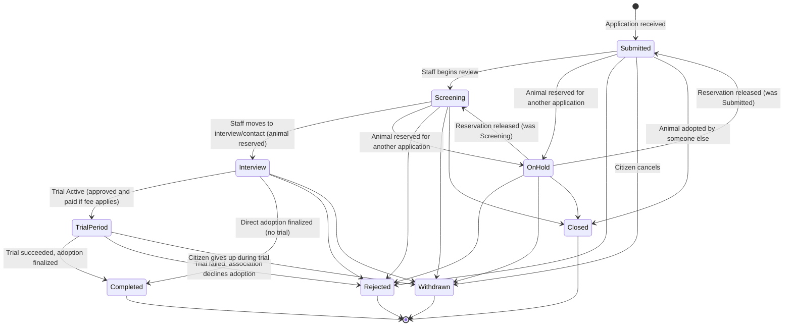
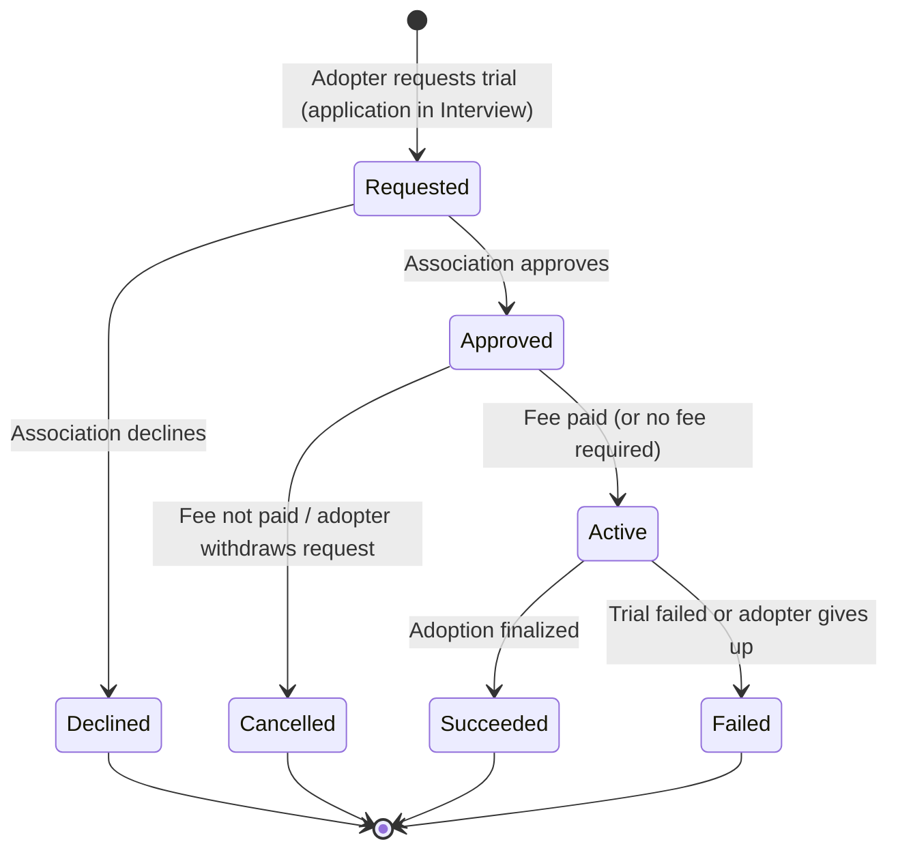
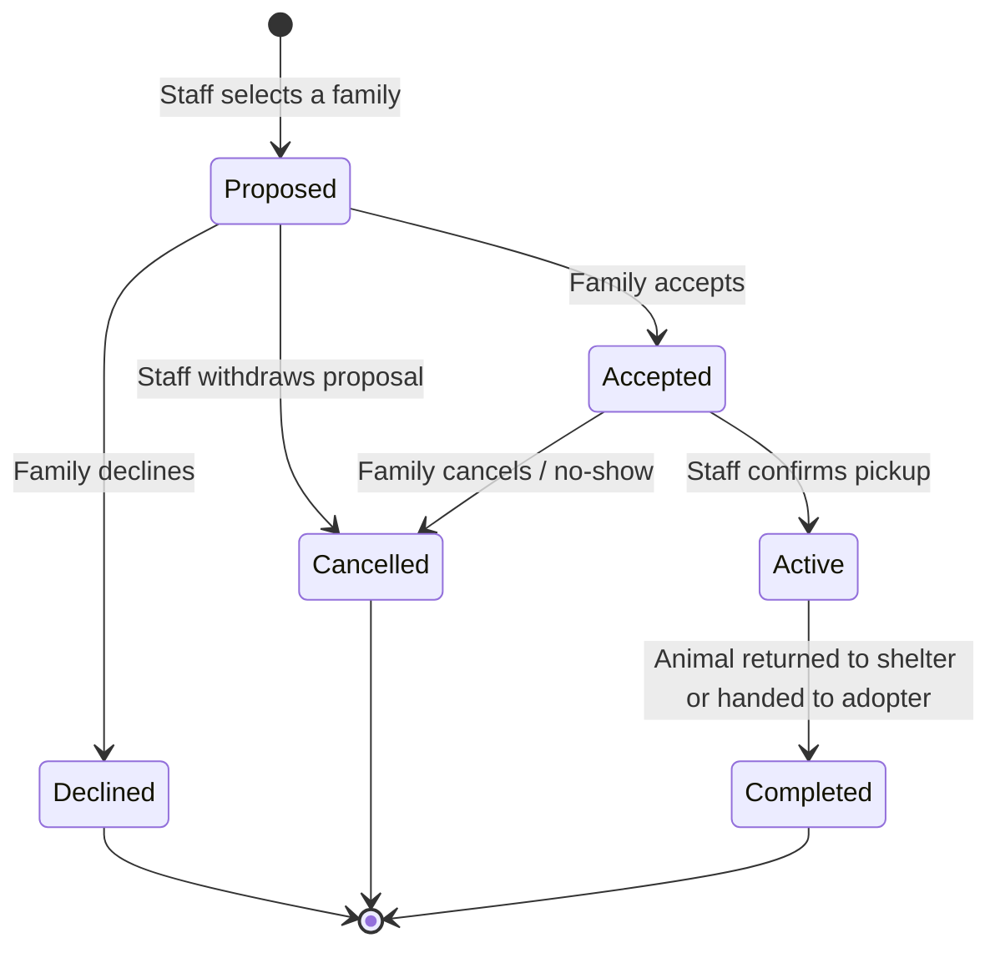
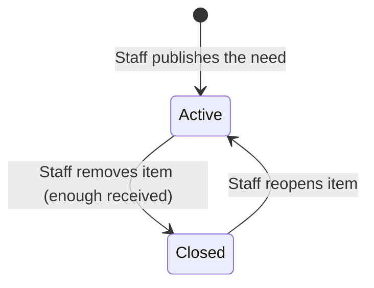
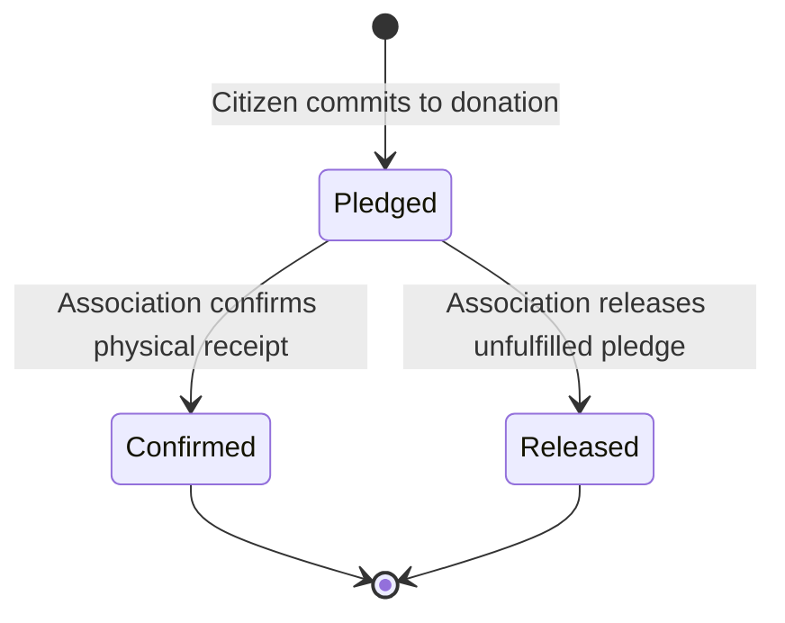
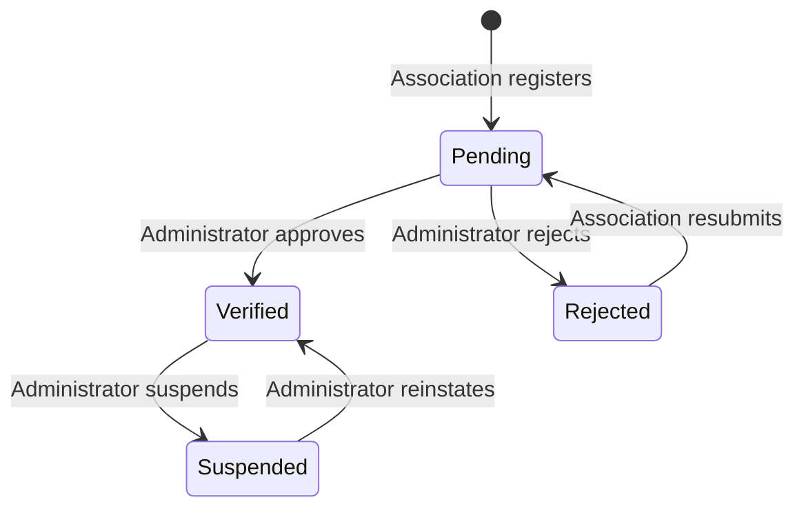

# State Machines

This document is the **normative source** for the lifecycles and transitions of the core entities in the Patas platform. Adhering to the project's strict Object-Oriented principles, each state machine is implemented with the **State Design Pattern**.

Machines covered:

1. Animal Adoption Status
2. Animal Location (orthogonal to 1)
3. Adoption Application
4. Trial Period (Foster-to-Adopt)
5. Foster Assignment (Temporary Fostering)
6. Wishlist Item and Pledge (Solidarity Wishlist)
7. Association Verification

[[#8. Cross-Machine Rules|Section 8]] defines the rules that keep these machines consistent with each other.

> The `Deceased` animal state is intentionally omitted to focus purely on actionable adoption states (Vision, Decision D5).

---

## 1. Animal Adoption Status

Notes:
* `Adopted` is **not** terminal: a return moves the animal back to `Available`.
* `Unavailable` is only reachable from `Available`. If an animal is `Reserved` and develops a medical issue, staff first releases the reservation (reject/withdraw the application), then marks it `Unavailable`.

## 2. Animal Location (Orthogonal State)

Independent of the Adoption Status, an animal's physical location is tracked. This is critical for the Parametric Temporary Fostering Engine.

Notes:
* `WithAdopter` covers the trial period and the time after a completed adoption.
* An animal in `AwaitingPickup` cannot start a trial or be handed over; the assignment must be cancelled first.
* An animal can be `Available` while `InFosterHome` or `AwaitingPickup`, or `Unavailable` while `AtShelter`.

## 3. Adoption Application

The `AdoptionApplication` tracks the journey of a citizen attempting to adopt a specific animal.

Notes:
* **Reservation rule:** moving an application to `Interview` reserves the animal. Only one application per animal can be in `Interview` or `TrialPeriod`; all other open applications go `OnHold`.
* When an application is released from `OnHold`, it resumes at the stage recorded in its status history (`application_status_changes`).
* `Closed` applies only to applications that never reserved the animal (`Submitted`, `Screening`, `OnHold`). The reserved application can never be closed by another adoption.
* If the trial is declined or cancelled (see [[#4. Trial Period (Foster-to-Adopt)|section 4]]), the application stays in `Interview`.
* Every transition is recorded in the application's status history (feeds the Adoption Tracker) and generates an email and an in-app notification.

## 4. Trial Period (Foster-to-Adopt)

The `TrialPeriod` entity has its own lifecycle. The adopter requests the trial; the association approves or declines it and may require a fee.

Effects on other machines:

| Trial transition | Application | Animal adoption status | Animal location |
| :--- | :--- | :--- | :--- |
| `Approved → Active` | `Interview → TrialPeriod` | `Reserved → InTrial` | `→ WithAdopter` |
| `Active → Succeeded` | `TrialPeriod → Completed` | `InTrial → Adopted` | stays `WithAdopter` |
| `Active → Failed` | `TrialPeriod → Rejected` or `Withdrawn` (outcome recorded) | `InTrial → Available` | `WithAdopter → AtShelter` |
| `Declined` / `Cancelled` | stays `Interview` | stays `Reserved` | unchanged |

Check-ins and notes can be logged only while the trial is `Active`.

## 5. Foster Assignment (Temporary Fostering)

A `FosterAssignment` links an animal to a Foster Family. It starts as a proposal and requires the family's acceptance (Decision D4).

Effects on the Animal Location machine:

| Assignment transition | Animal location |
| :--- | :--- |
| `Proposed → Accepted` | `AtShelter → AwaitingPickup` |
| `Accepted → Cancelled` | `AwaitingPickup → AtShelter` |
| `Accepted → Active` | `AwaitingPickup → InFosterHome` |
| `Active → Completed` (returned) | `InFosterHome → AtShelter` |
| `Active → Completed` (handed to adopter) | `InFosterHome → WithAdopter` |
| `Proposed → Declined / Cancelled` | unchanged |

An animal can have at most one assignment in `Proposed`, `Accepted` or `Active` at a time.

## 6. Solidarity Wishlist (Item and Pledge)

The wishlist has **no hard limits**. An item stays open for pledges until the association decides it has enough and closes it. Instead of a cap, each item has a soft **target** that drives its priority.

### 6.1 Wishlist Item

Rules:
* While `Active`, any Citizen can pledge **any quantity**; the target never blocks a pledge.
* `Closed` items are hidden from the public wishlist and refuse new pledges. Pledges already in `Pledged` status can still be confirmed or released.

### 6.2 Pledge

The `Pledge` entity tracks the lifecycle of an in-kind donation from the moment a citizen commits to it until the association physically receives the item.

A pledge is confirmed or released as a whole (Decision D2).

### 6.3 Quantities and Priority

Derived values on `WishlistItem`:
* `targetQuantity`: soft target set by Staff; informational, never a limit
* `confirmedQuantity` = sum of `Confirmed` pledges (what the shelter has received)
* `pledgedQuantity` = sum of `Pledged` pledges (promised, not yet received)
* `committedQuantity` = `confirmedQuantity + pledgedQuantity`
* `remainingToTarget` = `max(0, targetQuantity - confirmedQuantity)`
* `coverage` = `committedQuantity / targetQuantity`

Priority is derived from coverage and is used only to order and label items (High first):

| Priority | Coverage | Meaning |
| :--- | :--- | :--- |
| High | below 50% | Far from the target; donors should look here first |
| Medium | 50% to below 100% | Partly covered |
| Low | 100% or more | Target covered; still listed and still accepting pledges until closed |

The thresholds are defaults and can be tuned (Decision D6).

## 7. Association Verification

A new Association must be verified by the Platform Administrator before it can publish animals.

Rules:
* Only `Verified` associations can register or publish animals and wishlist items.
* While `Suspended`, the association's animals and wishlist are hidden from the public catalog; data is preserved.

## 8. Cross-Machine Rules

Aggregates reference each other by ID, so cross-aggregate effects are coordinated through domain events handled by application services (not by direct object references).

| Event | Reaction |
| :--- | :--- |
| Application moves to `Interview` | Animal `Available → Reserved`; other open applications `→ OnHold` |
| Reserved application `Rejected` / `Withdrawn` | Animal `Reserved → Available`; held applications resume |
| Trial `Active` | Application `→ TrialPeriod`; animal `→ InTrial`, location `→ WithAdopter` (active foster assignment, if any, completes) |
| Direct adoption finalized | Application `→ Completed`; animal `Reserved → Adopted`, location `→ WithAdopter` |
| Animal becomes `Adopted` | All `Submitted`/`Screening`/`OnHold` applications `→ Closed` |
| Animal returned after trial or adoption | Animal `→ Available`, location `→ AtShelter` |
| Any application transition | Status history entry + email + in-app notification |
| Wishlist item closed | New pledges refused; existing `Pledged` pledges can still be confirmed or released |

Invariants:
* Trial start or direct adoption requires location `AtShelter` or `InFosterHome` (never `AwaitingPickup`).
* A foster assignment can only be proposed for an animal whose location is `AtShelter` and whose adoption status is `Available`, `Reserved` or `Unavailable` (not `InTrial` or `Adopted`).

## 9. Implementation Notes (State Pattern)

To implement these machines without massive `if/switch` blocks:
* Create one state interface per machine, e.g. `AnimalAdoptionState`, `AnimalLocationState`, `ApplicationState`, `TrialState`, `FosterAssignmentState`, `PledgeState`, `WishlistItemState`, `VerificationState`.
* Example for the animal: `AnimalAdoptionState` exposes `reserve()`, `startTrial()`, `completeAdoption()`, `release()`, `markUnavailable()`, `returnAnimal()`; concrete classes are `AvailableState`, `ReservedState`, `InTrialState`, `AdoptedState`, `UnavailableState`.
* If an invalid operation is called (e.g. `startTrial()` on `AvailableState`), the state object throws a Domain Exception, ensuring strict adherence to the rules above.
* The `Animal` aggregate holds **two** state objects (adoption status and location).
* Each state class should be unit-tested in isolation; the cross-machine rules in [[#8. Cross-Machine Rules|section 8]] need a small set of integration tests.
