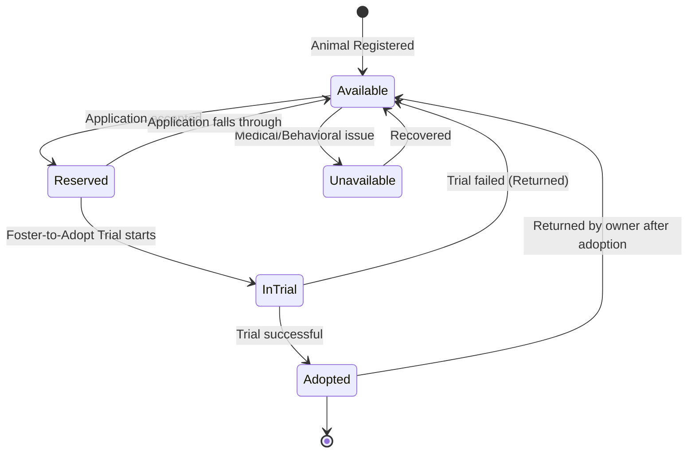
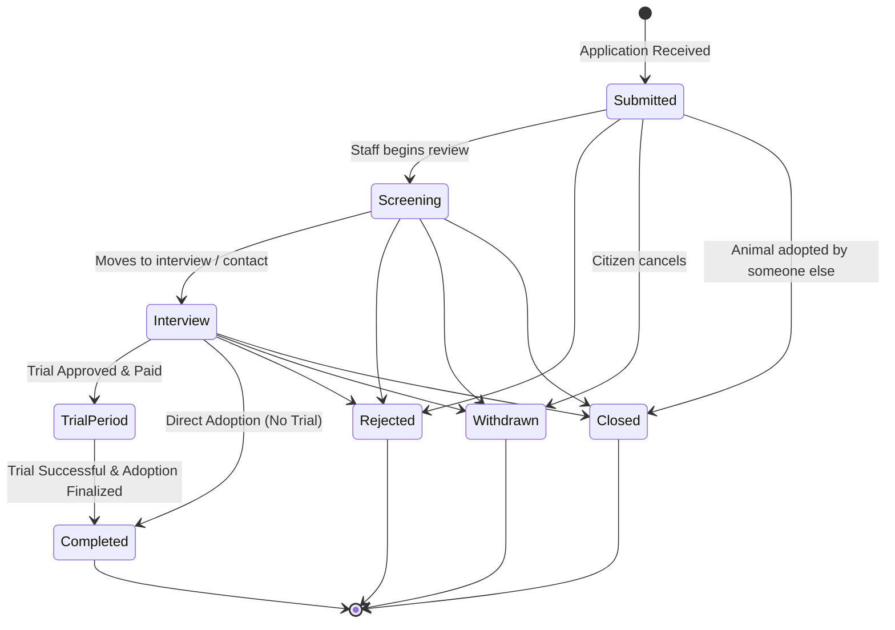

# State Machines

This document formalizes the lifecycle and transitions for the core entities in the Patas platform. Adhering to the project's strict Object-Oriented principles, these state machines will be implemented using the **State Design Pattern**.

## 1. Animal Lifecycle

The `Animal` aggregate has its primary lifecycle dictated by its progress toward adoption.

*(Note: Per our earlier discussion, the 'Deceased' state has been intentionally omitted to focus purely on actionable adoption states).*

### Animal Location (Orthogonal State)
Independent of the Adoption Status above, an animal also has a physical `Location` state:
*   `At Shelter`
*   `In Foster Home` (Temporary Fostering)

An animal can be `Available` while `In Foster Home`, or `Unavailable` while `At Shelter`.

---

## 2. Adoption Application Lifecycle

The `AdoptionApplication` tracks the journey of a citizen attempting to adopt a specific animal.

## Implementation Notes (State Pattern)
To implement this in code without massive `if/switch` blocks:
*   Create an `AnimalState` interface with methods like `reserve()`, `startTrial()`, `completeAdoption()`.
*   Create concrete classes: `AvailableState`, `ReservedState`, `InTrialState`, etc.
*   If `startTrial()` is called while the animal is in the `AvailableState` (it bypassed Reserved), the state object throws a Domain Exception, ensuring strict adherence to the business rules mapped out above.
