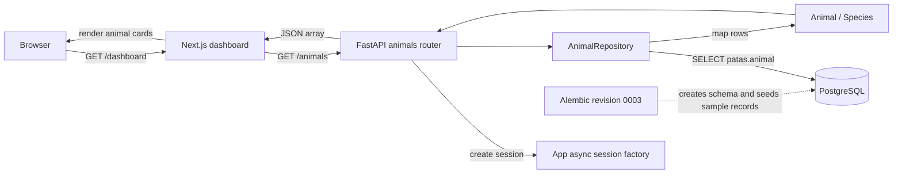

# ADR 0004: Fetching Animal Data for the Dashboard

| | |
| :-- | :-- |
| **Status** | Accepted |
| **Date** | 2026-10-20 |
| **Scope** | Animal listing vertical slice |
| **Related** | [[0001-authentication]], [[0002-deployment-and-runtime-architecture]] |

## Context

The dashboard needs to display animal records stored in PostgreSQL. The frontend
should not connect directly to the database: the backend owns access to domain data
and exposes it through an HTTP API.

## Decisions

1. **The Next.js dashboard fetches data server-side.** The `/dashboard` page calls
   `GET /animals` from its server-rendered component. In Docker Compose it addresses
   the backend using `BACKEND_URL=http://backend:8000`; it does not send the database
   connection or this request through the user's browser. The page disables fetch
   caching so each request reads current backend data.
2. **FastAPI exposes a read-only collection endpoint.** The animals router registers
   `GET /animals` and returns a JSON array.
   The route obtains an `AsyncSession` from the session factory configured when the
   app is created, then delegates retrieval to `AnimalRepository`.
3. **The repository owns database reads and row mapping.** `AnimalRepository` issues
   an explicit SQLAlchemy Core `SELECT` against `patas.animal`, orders by name and id,
   and maps rows into domain `Animal` objects. It does not commit or mutate data.
4. **The domain model is independent of persistence.** `Animal` is a frozen dataclass
   containing its UUID, `Species`, name, and owner UUID. It trims names and rejects
   blank values; `Species` defines the supported `CAT`, `DOG`, and `RABBIT` values.
   The API response model serializes these values for the frontend.
5. **Alembic owns the animal table's schema and initial sample records.** Revision
   `0003` creates the `patas.species` enum and `patas.animal` table, then inserts six
   sample animals without duplicating existing IDs. The dashboard consumes records
   through the API rather than relying on frontend static data.
6. **The dashboard validates the API response at runtime.** It checks that the
   response is an array of animals with supported species and correctly shaped
   fields; a failed HTTP response or invalid payload raises an error instead of
   silently displaying a success-shaped fallback.
7. **The endpoint is currently public and read-only.** `GET /animals` has no
   authentication dependency. `owner_id` is returned as data but is not backed by a
   foreign-key constraint in this migration. Authorization, filtering, and animal
   creation or update flows are outside this slice.

## Data Flow

## Consequences

* **Positive:** The browser and frontend do not need database access; persistence,
  domain mapping, and HTTP representation have distinct responsibilities.
* **Positive:** Server-side fetching avoids exposing the backend-to-database path to
  the browser, and uncached requests reflect the latest available records.
* **Negative:** The dashboard depends on the backend being reachable and on its
  response shape remaining compatible; failures surface as a page error.
* **Negative:** The current public endpoint provides no user-specific authorization,
  and `owner_id` is not referentially enforced. These limitations must be addressed
  before exposing private or user-owned animal data.