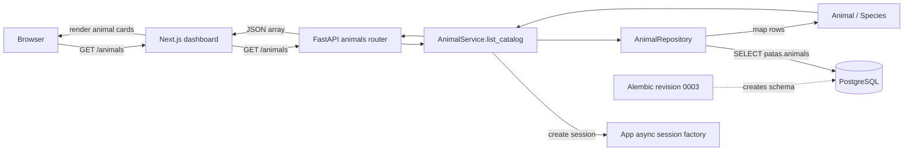

# ADR 0005: Fetching Animal Data for the Dashboard

| | |
| :-- | :-- |
| **Status** | Accepted |
| **Date** | 2026-10-20 |
| **Scope** | Animal listing vertical slice |
| **Related** | [[0001-authentication]], [[0002-deployment-and-runtime-architecture]], [[0004-animal-aggregate]], [[0006-application-services]] |

## Context

The dashboard needs to display animal records stored in PostgreSQL. The frontend
should not connect directly to the database: the backend owns access to domain data
and exposes it through an HTTP API.

## Decisions

1. **The Next.js catalog fetches data server-side.** The public `/animals` page calls
   `GET /animals` from its server-rendered component. In Docker Compose it addresses
   the backend using `BACKEND_URL=http://backend:8000`; it does not send the database
   connection or this request through the user's browser. The page disables fetch
   caching so each request reads current backend data. The "Publish an animal"
   button appears only to logged-in users; `/animals/new` and its Server Action
   check the session themselves, and the action calls `POST /animals` with the
   session's JWT as a Bearer token.
2. **FastAPI exposes a read-only collection endpoint.** The animals router registers
   `GET /animals` and returns a JSON array.
   The route delegates to `AnimalService.list_catalog`, which opens a session from
   the app's session factory and reads through `AnimalRepository`
   ([[0006-application-services]]).
3. **The repository owns database reads and row mapping.** `AnimalRepository` issues
   an explicit SQL `SELECT` against `patas.animals`, newest first, and maps rows into
   domain `Animal` objects. It never commits; the caller owns the transaction.
4. **The domain model is independent of persistence.** `Animal` is the aggregate from
   [[0004-animal-aggregate]]: species `dog`, `cat` or `other`, an optional age in
   months, and an adoption status that starts `available`. It trims names and rejects
   blank names and negative ages. `AnimalResponse.from_domain` serializes it for the
   frontend.
5. **Alembic owns the animal table's schema.** Revision `0003` creates the
   `patas.species` and `patas.adoption_status` enums and the `patas.animals` table,
   whose `owner_id` references `patas.users`. It inserts no sample rows: demo data is
   created through the application. The dashboard consumes records through the API
   rather than relying on frontend static data.
6. **The dashboard validates the API response at runtime.** It checks that the
   response is an array of animals with supported species and correctly shaped
   fields; a failed HTTP response or invalid payload raises an error instead of
   silently displaying a success-shaped fallback.
7. **The catalog endpoint is public and read-only.** `GET /animals` has no
   authentication dependency (spec AC5). Publishing an animal is a separate,
   authenticated concern (spec AC1, AC2). Filtering and update flows are outside this
   slice.

## Data Flow

## Consequences

* **Positive:** The browser and frontend do not need database access; persistence,
  domain mapping, and HTTP representation have distinct responsibilities.
* **Positive:** Server-side fetching avoids exposing the backend-to-database path to
  the browser, and uncached requests reflect the latest available records.
* **Negative:** The dashboard depends on the backend being reachable and on its
  response shape remaining compatible; failures surface as a page error.
* **Negative:** The catalog is public, so it must only ever return data that is safe
  to show to visitors. Private or user-specific animal data needs its own endpoint.