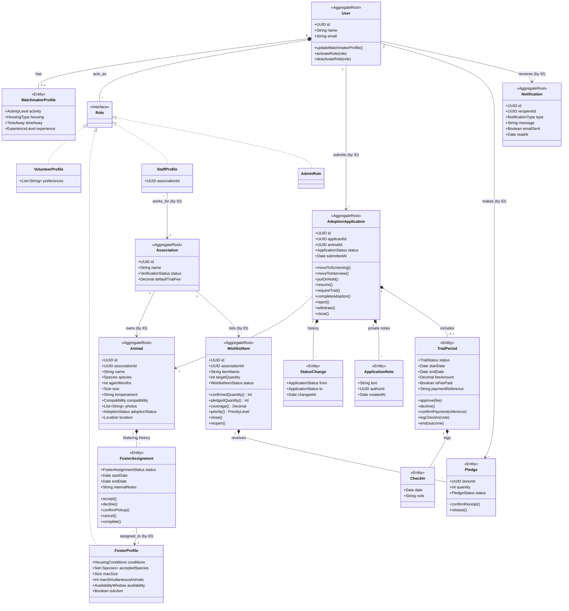

# Conceptual Domain Model

This document outlines the core aggregates, entities, and relationships for the Patas platform, adhering strictly to Object-Oriented principles. Lifecycles are defined in [StateMachines](StateMachines.md); terminology in [Glossary](Glossary.md).

**Notation:** composition (`*--`) is used only *inside* an aggregate. Relationships between different aggregates are plain associations that reference the other aggregate **by ID**.

## Core UML Domain Model

## Modeling Decisions & Rationale

1. **Composition over Inheritance for Roles:** A `User` *has* a collection of `Role` objects (`VolunteerProfile`, `FosterProfile`, `StaffProfile`, `AdminRole`). A single person can gain or lose capabilities (e.g., becoming a volunteer for a while, then stopping) without changing their underlying class.
2. **Staff and Administrator are Roles:** `StaffProfile` carries the `associationId`, which is what enforces data isolation between associations: staff only see records whose `associationId` matches. `AdminRole` has no association and grants the platform-wide verification and moderation capabilities.
3. **Aggregate boundaries:** `Association`, `Animal`, `AdoptionApplication`, `WishlistItem`, `User` and `Notification` are separate aggregate roots that reference each other by ID. Composition is used only within an aggregate (e.g., `Pledge` inside `WishlistItem`). Cross-aggregate effects are coordinated through domain events (see [StateMachines section 8](StateMachines.md#8-cross-machine-rules)), which also lets an Association be loaded without loading all its animals.
4. **Matchmaker Profile as an Entity:** The `MatchmakerProfile` is an editable entity tied to the `User`, so citizens can update their lifestyle conditions over time to get better recommendations. It includes previous experience, as required by the Vision. Visitors' quiz answers are session-only and never stored. The animal side of the match relies on the `Animal` attributes (size, temperament, compatibility), which also power the catalog filters.
5. **Trial Period as a Separate Entity:** `TrialPeriod` is an optional entity inside the `AdoptionApplication` aggregate, which avoids null fields (trial dates, fee) on standard adoptions. It owns its lifecycle (`TrialStatus`), its fee and payment reference, and its `CheckIn` log. The fee is copied from the association's `defaultTrialFee` at approval time, so later changes do not affect existing trials.
6. **Application history and private notes:** `StatusChange` entries are the source of the Adoption Tracker timeline (avoiding redundant previous status fields). `ApplicationNote` entries are private to the association's staff across all process stages and never exposed to the applicant.
7. **Wishlist and Pledge Aggregation:** `WishlistItem` receives multiple `Pledge` entities and has **no hard limit**: any quantity can be pledged while the item is `Active`, and Staff close the item when they have enough. Instead of a cap, `targetQuantity` is a soft target. From the pledges the item derives `confirmedQuantity` (received), `pledgedQuantity` (promised), `coverage` (committed divided by target) and a `priority` (High, Medium, Low) used to order the wishlist. See [StateMachines section 6](StateMachines.md#6-solidarity-wishlist-item-and-pledge).
8. **Parametric Foster Profiling:** `FosterProfile` is a `Role` attached to a `User`. Temporary fostering does not require a separate account; a Citizen toggles the Foster Family role and defines `HousingConditions`, accepted species, maximum size, simultaneous capacity and an availability window. The Parametric Engine matches these against an animal's needs and excludes families at capacity or outside their window.
9. **Foster Assignment history:** An `Animal` keeps its `FosterAssignment` history (zero or more entries), with at most one assignment in `Proposed`, `Accepted` or `Active` status at any time. The assignment's status drives the animal's `Location` (see [StateMachines section 5](StateMachines.md#5-foster-assignment-temporary-fostering)).
10. **Notifications:** `Notification` is its own aggregate, created by domain events (every application state change, trial and foster updates). It supports both in-app delivery (`readAt`) and email (`emailSent`).
11. **State Pattern:** `Animal` holds two state objects (adoption status and location); `AdoptionApplication`, `TrialPeriod`, `FosterAssignment`, `Pledge`, `WishlistItem` and `Association` each hold one. Details in [StateMachines](StateMachines.md).
