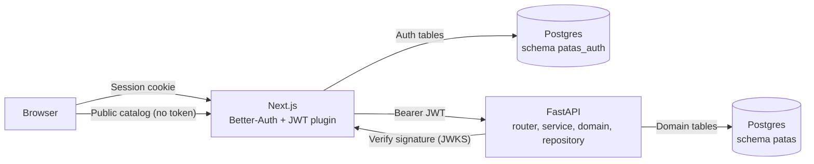

# Vertical Prototype Specification: Publish an Animal, See It in the Catalog

| Metadata | Detail |
| :--- | :--- |
| **Project** | Patas: Collaborative Animal Welfare Platform |
| **Context** | MESW, Software Engineering Laboratory (2026/27), Integration 0 sprint review |
| **Status** | DRAFT: slice chosen by the team; two technical decisions (§7) still pending confirmation |
| **Related documents** | [MVPVision](../../product/MVPVision.md) (A1, A2), [AuthenticationResearch](../../research/AuthenticationResearch.md), [DEFINITION_OF_DONE](../../process/DEFINITION_OF_DONE.md), [DatabaseDesignDecisions](../../architecture/DatabaseDesignDecisions.md) |

---

## 1. Purpose

The vertical prototype is **one thin feature** that:

1. **Validates the tech stack** end to end (Next.js, Better-Auth, FastAPI, PostgreSQL, Docker Compose, CI).
2. **Exercises the Definition of Done** on a real story, so the team learns the process before the real sprints.

It is not a mini MVP. It is chosen to cross every risky layer once: the Better-Auth JWT handoff to FastAPI, the domain layer, real persistence, and the CI pipeline.

## 2. Slice Definition

**Demo story:** a person registers and logs in, publishes an animal, and the animal appears in the public catalog. The data comes from PostgreSQL and the publisher is recorded as the owner.

Corresponds to MVP features **A1** (listing management, reduced to *create*) and **A2** (public catalog, reduced to *list*), on top of **F1** (authentication).

### 2.1 Alternatives considered

| Option | Description | Why not chosen |
| :-- | :-- | :-- |
| **A. Publish an animal, see it in the catalog** | Auth, create, list | **Chosen**: smallest slice that crosses auth, domain and persistence |
| B. Apply and track | Application state machine, reservation, tracker timeline | Larger; needs team alignment on business rules (the MVP Vision is still a draft) |
| C. Matchmaker score on seeded animals | Strategy pattern over JSONB data | Does not exercise auth; the algorithm is still under research |

### 2.2 Acceptance criteria (DoD #1)

| # | Criterion |
| :-- | :-- |
| AC1 | A logged-in user submits a valid animal; it appears in `GET /animals` with that user as owner and status `available`. |
| AC2 | A request without a valid JWT is rejected with 401 and nothing is stored. |
| AC3 | An invalid animal (blank name, negative age) is rejected by the domain and nothing is stored. |
| AC4 | The first authenticated call creates the user's row in `patas.users` (JIT provisioning). A second call does not duplicate it. |
| AC5 | The catalog is public: a visitor without login sees the published animals. |

### 2.3 Out of scope

Photos, filters, edit and unpublish, full-text search, matching, applications, notifications, moderation. No design pattern (State, Strategy, Observer) is introduced, because the slice has no concrete need for one (`AGENTS.md` §2, DoD #6).

## 3. Architecture

### 3.1 Frontend (Next.js)

* Better-Auth with email and password, and the JWT plugin. Its tables live in the `patas_auth` schema, isolated from the domain schema.
* Pages: `/register`, `/login`, `/animals` (public catalog, server-rendered from FastAPI), `/animals/new` (protected form).
* The Next.js server obtains the JWT for the session and calls FastAPI with `Authorization: Bearer <token>`.

### 3.2 Backend (FastAPI)

Layers: **router → application service → domain → repository**.

* **Domain:** the `Animal` entity enforces its own invariants (non-blank name, age greater than or equal to 0, starts `available`). No anemic model (`AGENTS.md` §2).
* **Auth dependency:** verifies the JWT signature and extracts `sub` and `email`. If no `patas.users` row exists for `sub`, it creates one (JIT provisioning, see [AuthenticationResearch](../../research/AuthenticationResearch.md) §4).
* **Repository:** SQLAlchemy async with asyncpg.
* **Endpoints:** `POST /animals` (authenticated), `GET /animals` (public).

### 3.3 Database

An Alembic migration creates only what the slice needs: `users` and `animals` (with `owner_id` referencing `users`, per decisions MD1 and MD2 of [MVPVision](../../product/MVPVision.md)). The status column uses the existing `adoption_status` values.

## 4. Test Strategy (DoD #3)

* `pytest` with `httpx` against the real FastAPI app and a **real PostgreSQL**, with a signed test JWT standing in for the Next.js side.
* Every acceptance criterion maps to at least one test that fails on a real regression.
* **AC1 is the vertical slice:** HTTP request in, row in the database, read back through the public endpoint.
* No tests that only mock the implementation (`AGENTS.md` §3).

## 5. CI and Linters (DoD #4, #5)

GitHub Actions with a PostgreSQL service:

| Part | Checks |
| :-- | :-- |
| Backend | ruff (to be added, no linter is configured yet), pytest |
| Frontend | eslint, `tsc`, `next build` |

## 6. Delivery (DoD #11, #12)

* Incremental commits, in this order: compose and migration, domain, API, auth, frontend, CI (no Friday Dump).
* A seed script for demo data (real data through the application, not static mockups).
* Tag **`iter-0`**, with short demo steps in the README so someone else can run it.

## 7. Pending Decisions (to confirm before implementation)

Both are structural decisions and need an ADR (`AGENTS.md` §6, DoD #7).

| # | Decision | Recommendation | Trade-off |
| :-- | :-- | :-- | :-- |
| D1 | **How FastAPI verifies the JWT** | Asymmetric verification through Better-Auth's JWKS endpoint | FastAPI holds no secret, but depends on the Next.js service being reachable to fetch keys. The alternative, a shared HS256 secret, is simpler but both services share a secret. |
| D2 | **Who owns the `patas` schema** | Alembic is the source of truth; `database/create.sql` stays as reference | The slice needs `animals.owner_id`, while `create.sql` still has `association_id`. Reconciling the full schema with the MVP Vision is a separate task. |

## 8. Known Gaps

* [MVPVision](../../product/MVPVision.md) is still a draft, and `database/create.sql`, [DomainModel](../../domain/DomainModel.md) and [StateMachines](../../domain/StateMachines.md) still describe the association model. The slice follows the MVP Vision decisions (owner is a `User`).
* The business logic of this slice is minimal (field validation only). Agreement on it is recorded as DoD #2 evidence in the PR.
