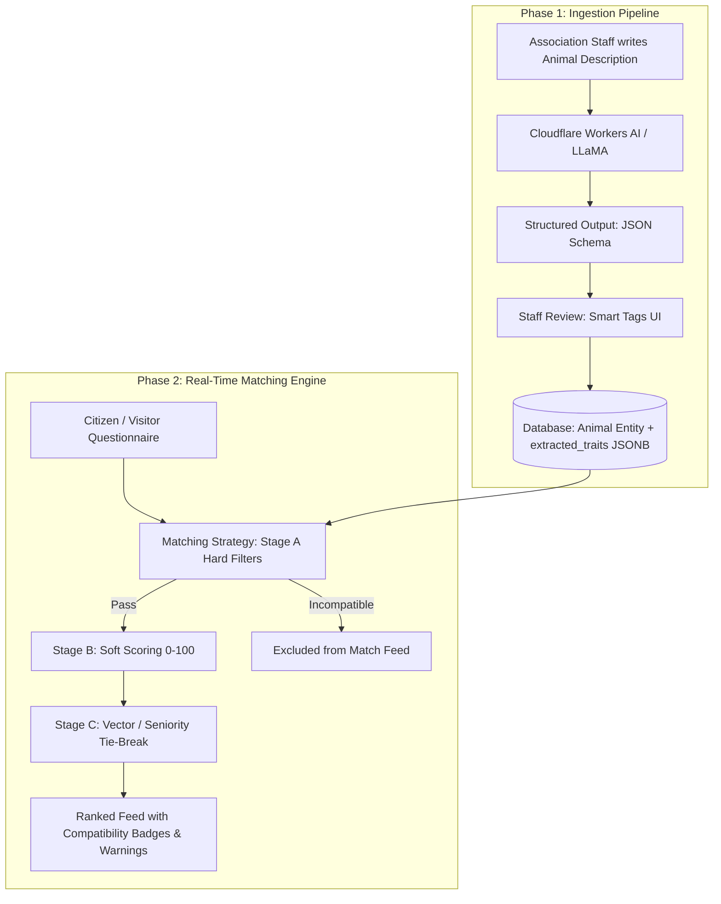
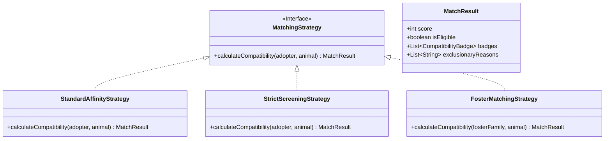

# Architecture & Specification: Animal Adoption Matching Engine & Platform

This document consolidates the technical investigation, data architecture, matching/recommendation engine logic, and product expansion roadmap for the **Patas** collaborative animal welfare platform.

---

## 1. Core Problem & Motivation

The primary challenge consists of bridging **structured data** (answers from a lifestyle and routine questionnaire submitted by an adopter) with **unstructured data** (free-text shelter notes / descriptions inserted by animal protection associations in the `Animal` entity).

* **Risk of Naive Approaches (Keyword Search):** Performing keyword searches over raw text queries produces catastrophic false positives (e.g., the sentence *"not good with small children"* matches the keyword *"children"*) and severely degrades database indexing and query performance.
* **Risk of Pure Vector Search (Embeddings Only):** Semantic embeddings struggle with strict negations and logical constraints because contradictory statements (e.g., *"loves cats"* vs. *"attacks cats"*) share near-identical semantic contexts and vector spaces.

---

## 2. Architectural Solution: Two-Phase Pipeline

To guarantee deterministic, ultra-fast queries for users while minimizing LLM operational costs, the architecture decouples processing into **Asynchronous Ingestion** (executed once upon animal profile creation/update) and **Deterministic Matching** (executed in real time in memory or via SQL).



### Phase 1: Ingestion & Trait Extraction

Whenever an association registers or updates an animal, the free-text `description` field is processed by an LLM with **Structured Outputs (`json_schema`)**. This extracts standardized behavioral flags and stores them in structured columns and an `extracted_traits` JSONB column on the `Animal` aggregate.

* **Recommended Provider (Zero Cost):** **Cloudflare Workers AI** (10,000 free Neurons/day, allowing ~300 to 800 profile extractions per day using `@cf/meta/llama-3.1-8b-instruct` or `llama-3.2-3b-instruct`).
* **Alternative Providers:** Google AI Studio (Gemini 2.5 Flash Free Tier), Groq Cloud API (Llama 3.3 Free Tier), or local inference via Ollama.
* **Human-in-the-Loop & Graceful Degradation:** The extracted tags are presented to association staff as editable **Smart Tags** before saving. This guarantees 100% precision, saves volunteer time, and provides an immediate manual fallback if the external AI service is unreachable.

#### Extraction Schema (Structured JSON Output)

```javascript
const response = await env.AI.run("@cf/meta/llama-3.1-8b-instruct", {
  messages: [
    {
      role: "system",
      content: "Extract behavioral and care attributes from shelter notes. If a trait is not explicitly mentioned or clearly deducible, set it to 'unknown'."
    },
    {
      role: "user",
      content: animalDescription
    }
  ],
  response_format: {
    type: "json_schema",
    json_schema: {
      type: "object",
      properties: {
        good_with_dogs: { type: "string", enum: ["yes", "no", "unknown"] },
        good_with_cats: { type: "string", enum: ["yes", "no", "unknown"] },
        good_with_children: { type: "string", enum: ["yes", "no", "unknown"] },
        energy_level: { type: "string", enum: ["low", "medium", "high", "unknown"] },
        needs_yard: { type: "boolean" },
        experience_needed: { type: "string", enum: ["beginner", "intermediate", "experienced"] },
        barking_tendency: { type: "string", enum: ["low", "medium", "high", "unknown"] },
        special_needs: { type: "boolean" },
        bonded_pair: { type: "boolean" }
      },
      required: [
        "good_with_dogs",
        "good_with_cats",
        "good_with_children",
        "energy_level",
        "needs_yard",
        "experience_needed",
        "barking_tendency",
        "special_needs",
        "bonded_pair"
      ]
    }
  }
});
```

---

### Phase 2: Schema Integration with `Animal` & `MatchmakerProfile`

To ensure clean querying, schema agility, and alignment with [DatabaseDesignDecisions](../architecture/DatabaseDesignDecisions.md) (Decision 12) and [DomainModel](../domain/DomainModel.md), data is partitioned between indexed relational columns and an extensible native JSONB compatibility profile:

| Layer | Source | Attributes | Storage & Usage |
| :--- | :--- | :--- | :--- |
| **Physical & Core Metadata** | Direct input by Staff | `species`, `size`, `age_in_months`, `adoption_status`, `location` | Relational columns in `animals`; powers base catalog filtering and state machine transitions. |
| **Extensible Compatibility Profile (`compatibility`)** | Structured input / AI extraction + Staff confirmation | `good_with_children`, `good_with_dogs`, `good_with_cats`, `needs_yard`, `energy_level`, `experience_needed`, `barking_tendency`, `house_trained`, `bonded_pair`, etc. | Single native `compatibility jsonb NOT NULL DEFAULT '{}'::jsonb` column in `animals`, indexed with native GIN (`jsonb_path_ops`). Powers catalog cohabitation filters and the matching engine. |
| **Narrative (`description`)** | Written by Staff | Full history, medical background, rescue context | `text` column in `animals` with PostgreSQL `tsvector` GIN index for search. |

### 2.1. Architectural Rationale: Native JSONB vs. Static Relational Columns

The decision to consolidate all compatibility and behavioral attributes into a single native `compatibility jsonb` column (rather than maintaining rigid boolean columns) is governed by four key software engineering trade-offs:

1. **Schema Agility & Zero Migration Friction:**
   During agile iterations and algorithm calibration, the team regularly introduces new criteria (e.g., `needs_yard`, `barking_tendency`, `house_trained`, `good_with_birds`, `time_alone_tolerance`, `hypoallergenic`). Storing these as individual relational columns would require database migrations, altering baseline schemas, and deploying schema updates for every single new trait. With native JSONB, new criteria can be extracted and consumed immediately without touching the database schema.
2. **Rich Domain Model & Value Object Pattern (AGENTS.md Compliance):**
   In Domain-Driven Design, compatibility is not an independent entity with lifecycle or relational identity; it is a multi-dimensional **Value Object** (`CompatibilityProfile` inside the `Animal` Aggregate Root, mirroring `+Compatibility compatibility` in [DomainModel](../domain/DomainModel.md)). Relational normalization is preserved for core transactional state (`adoption_status`, `location`, `association_id`), while the behavioral profile is cleanly encapsulated.
3. **Native PostgreSQL 16 Performance (`jsonb_path_ops` & Containment `@>`):**
   Both `jsonb` and the `jsonb_path_ops` operator class are **100% native PostgreSQL core features** requiring zero external extensions. A GIN index with `jsonb_path_ops` hashes paths and values into compact index entries, enabling ultra-fast containment queries:
   ```sql
   -- Fast index scan for catalog filtering and Stage A hard filters:
   SELECT * FROM animals WHERE compatibility @> '{"good_with_cats": true, "needs_yard": true}';
   ```
4. **Two-Tier Validation Strategy ("The Room Wins"):**
   * *Database Level:* Enforced by a native check constraint `CONSTRAINT animals_compatibility_is_object_check CHECK (jsonb_typeof(compatibility) = 'object')`, ensuring the payload is always a valid JSON object.
   * *Application Level:* Strongly typed by a Pydantic v2 schema in FastAPI (`CompatibilityProfile`), validating types, defaults, and allowed enums before data touches the database.

> **Alignment Note for `MatchmakerProfile`:**  
> The current baseline schema (`matchmaker_profiles`) stores `activity`, `housing`, `time_away`, and `experience`. To execute the critical safety filters (Hard Filters), the profile must also record household composition: `has_children boolean`, `has_dogs boolean`, and `has_cats boolean` (or equivalent list of existing pets).

---

## 3. The 3-Stage Matching Funnel

The matching engine **never calls an LLM at query time**. Instead, it executes deterministic domain logic modeled via the **Strategy Pattern** (mandated in [AGENTS](../../AGENTS.md)).

### Stage A: Hard Filters (Eliminatory Criteria)
Eliminates candidates where an objective lifestyle clash creates an unsafe or unacceptable environment:
1. **Housing vs. Yard Requirement:** Adopter has no yard (`housing = 'apartment'` or `'house_no_yard'`) $\land$ Animal strictly requires outdoor space (`needs_yard = true`) $\rightarrow$ **Excluded**.
2. **Existing Cats vs. Feline Incompatibility:** Adopter has resident cats (`has_cats = true`) $\land$ Animal is aggressive/incompatible (`good_with_cats = false`) $\rightarrow$ **Excluded**.
3. **Existing Children vs. Child Incompatibility:** Adopter has children (`has_children = true`) $\land$ Animal is incompatible with kids (`good_with_children = false`) $\rightarrow$ **Excluded**.
4. **Existing Dogs vs. Canine Incompatibility:** Adopter has resident dogs (`has_dogs = true`) $\land$ Animal is incompatible with dogs (`good_with_dogs = false`) $\rightarrow$ **Excluded**.

> **The Asymmetry Rule:** If an animal is marked as incompatible with children (`good_with_children = false`), but the adopter **has no children** (`has_children = false`), the animal **is not penalized**. This gives visibility to traumatized or selective shelter animals without placing them at risk.

---

### Stage B: Soft Scoring (Weighted Affinity from 0 to 100)

Every animal that passes Stage A starts with an initial score of $100$ and receives deductions and bonuses:

$$\text{AffinityScore} = \max\left(0, \min\left(100, 100 - \sum \text{Penalties} + \sum \text{Bonuses}\right)\right)$$

1. **Energy Level Compatibility (High Weight - max deduction 30 pts):**
   * Difference between adopter routine level ($E_{user} \in \{1, 2, 3\}$) and animal energy ($E_{animal} \in \{1, 2, 3\}$):
     $$\text{Penalty}_{\text{energy}} = |E_{user} - E_{animal}| \times 15$$
2. **Experience Deficit (Medium Weight - deduction 20 pts):**
   * If the animal requires more experience than the adopter has ($Exp_{animal} > Exp_{user}$):
     $$\text{Penalty}_{\text{experience}} = (Exp_{animal} - Exp_{user}) \times 20$$
   * If $Exp_{user} \ge Exp_{animal}$, zero penalty.
3. **Uncertainty Management (`NULL` / `"unknown"`):**
   * If an adopter has cats and the animal has `good_with_cats IS NULL` (never tested with cats):
     * The animal is **not eliminated** (to avoid hiding viable rescues).
     * Applies a moderate penalty ($-20\text{ pts}$).
     * Attaches a high-priority UI warning badge: *"Caution: Never tested with cats — gradual introduction required"*.
4. **Schedule Compatibility (Time Away from Home):**
   * High-energy or separation-anxious animals matched with users away for `most_of_day` incur a deduction ($-15\text{ pts}$).

---

### Stage C: Tie-Breaking & Semantic Ordering (Optional)

When multiple candidates share identical or near-identical affinity scores, sorting applies:
1. **Shelter Seniority (Primary Tie-Breaker):** Animals that have been waiting longest for adoption (`created_at ASC`) receive priority ranking to combat long-term shelter stays.
2. **Semantic Similarity (Optional Extension):** In future iterations, a weighted combination can blend rule-based affinity with vector cosine similarity between adopter preferences and profile notes:
   $$\text{FinalScore} = (0.8 \times \text{AffinityScore}) + (0.2 \times \text{VectorScore})$$

---

## 4. End-to-End Walkthrough Example

### Adopter Profile: "Marta"
* **Housing:** Apartment without private yard (`housing = 'apartment'`)
* **Household:** No children (`has_children = false`)
* **Existing Pets:** 1 resident cat (`has_cats = true`, `has_dogs = false`)
* **Routine / Activity:** Calm / Remote Worker (`activity = 'low'`, score = 1)
* **Experience:** Intermediate (`experience = 'some'`, score = 2)

### Matching Evaluation Against 3 Sample Animals

| Candidate Animal | Shelter Notes Summary | Extracted Traits | Stage A (Hard Filter) | Stage B (Soft Score) | Final Match & UI Badges |
| :--- | :--- | :--- | :--- | :--- | :--- |
| **1. Bolinhas** | Very high energy dog; requires large fenced yard; must be the only pet. | `energy: high (3)`, `needs_yard: true`, `cats: false`, `dogs: false` | ❌ **Eliminated**<br>(Requires yard + cannot live with cats) | N/A | **0% (Hidden from Match Feed)** |
| **2. Luna** | Quiet, senior cat. Afraid of children; gets along well with other cats. | `energy: low (1)`, `needs_yard: false`, `cats: true`, `kids: false`, `exp: beginner (1)` | ✅ **Passed**<br>(Child incompatibility safely ignored because Marta has no kids) | `100 - 0 (Energy) - 0 (Cats) - 0 (Exp)` | 🏆 **100% Match**<br>🟢 *Ideal for apartment living*<br>🟢 *Compatible with resident cats* |
| **3. Max** | Young energetic crossbreed; friendly and calm indoors; untested with cats. | `energy: moderate (2)`, `needs_yard: false`, `cats: unknown (NULL)`, `kids: true`, `exp: beginner (1)` | ✅ **Passed**<br>(Untested status does not block candidate) | `100 - 15 (Energy delta = 1) - 20 (Untested cat penalty)` | 🥈 **65% Match**<br>🟢 *Good for apartment*<br>🟠 *Notice: Never tested with cats* |

---

## 5. Domain Modeling & Object-Oriented Design (AGENTS.md Compliance)

In accordance with the OOP and Design Patterns requirements established in [AGENTS](../../AGENTS.md):

### 1. Strategy Pattern (`MatchingStrategy`)
The calculation of compatibility must not be written as a procedural script. An interchangeable `MatchingStrategy` hierarchy encapsulates algorithm variants:



* **`StandardAffinityStrategy`:** The public consumer strategy used for the interactive Matchmaker quiz and catalog swipe feed.
* **`StrictScreeningStrategy`:** Used by Association Staff in the back-office Kanban during formal application review, enforcing zero-tolerance policies on missing requirements.
* **`FosterMatchingStrategy`:** Executes the parametric fostering calculations matching an animal's medical/care needs against `FosterProfile` attributes (housing conditions, species, size cap, time window).

### 2. Value Objects and Aggregates
* **`MatchResult`:** A rich Value Object returning the numerical score, eligibility flag, structured breakdown of penalties/bonuses, and UI badge tokens.
* **`CompatibilityBadge`:** Encapsulates visual sentiment (positive green, neutral grey, cautionary amber) and localized human-readable explanations.

---

## 6. Infrastructure & Image Hosting (Cloudflare Stack)

### Cloudflare R2 vs. AWS S3
For photo storage across both the catalog and the swipe matching interface, **Cloudflare R2** is the recommended solution:
* **S3 API Compatibility:** Works seamlessly with standard AWS SDKs (`@aws-sdk/client-s3` in Node/TS, `boto3` in Python).
* **Zero Egress Fees:** Eliminates egress bandwidth charges for public image views, avoiding unexpected billing spikes on image-heavy consumer web apps.
* **Free Tier:** Includes 10 GB of storage and 10 million Class B read operations monthly.

### Media Pipeline Best Practices
1. **Client-Side Image Optimization:** Images are compressed and resized in the browser prior to upload (max `1080px`, WebP format at 80% quality), shrinking standard mobile uploads from ~6 MB to ~120 KB.
2. **Direct Uploads via Presigned URLs:** The FastAPI backend issues a pre-signed PUT URL, allowing the client to stream directly to the R2 bucket without exhausting backend memory or worker connections.
3. **Card Deck Pre-fetching:** The frontend client automatically pre-fetches images for the next 2–3 animal cards in the deck to guarantee zero latency on swipe interactions.

---

## 7. Product Roadmap & Strategic Extensions

### 7.1. Association Screening Dossier
When an application is submitted, Association Staff receive an auto-generated compatibility summary:
* **Validated Strengths:** e.g., *"Apartment verified; applicant meets required experience tier"*.
* **Dynamic Interview Guide:** Highlights open questions (e.g., *"Ask applicant if they are equipped for gradual scent introduction, as Max has no recorded history with cats"*).

### 7.2. Passive "Soulmate" Notifications
Visitors who take the Matchmaker quiz can save their profile. When an association registers an animal whose traits generate an affinity score $> 90\%$, a notification is dispatched automatically.

### 7.3. Parametric Foster & Sponsorship Pathways
Applicants whose questionnaire reveals constraints incompatible with full adoption (e.g., short-term residency, high travel frequency) are seamlessly guided to alternative engagement paths:
* **Temporary Fostering (FAT):** Matched for short recovery or kitten-season windows.
* **Solidarity Sponsorship (Apadrinhamento):** Paired with high-need or senior animals for monthly micro-donations and socialization visits.

### 7.4. Bonded Pairs Support
Animals requiring joint adoption (`bonded_pair: true`) are presented as linked dual-profile cards and filtered exclusively to adopters with household capacity for two pets.

### 7.5. Multimodal Computer Vision Assistance
When staff upload a photo, a lightweight vision model (e.g., `@cf/meta/llama-3.2-11b-vision-instruct`) suggests breed mixture, size tier, and fur type, generating a draft description that volunteers can edit with a single click.

### 7.6. Post-Adoption Adaptation Tracking
Automated, milestone-driven check-ins at **7, 30, and 90 days** post-adoption offer targeted care guides based on the animal's original trait profile, proactively preventing returns.